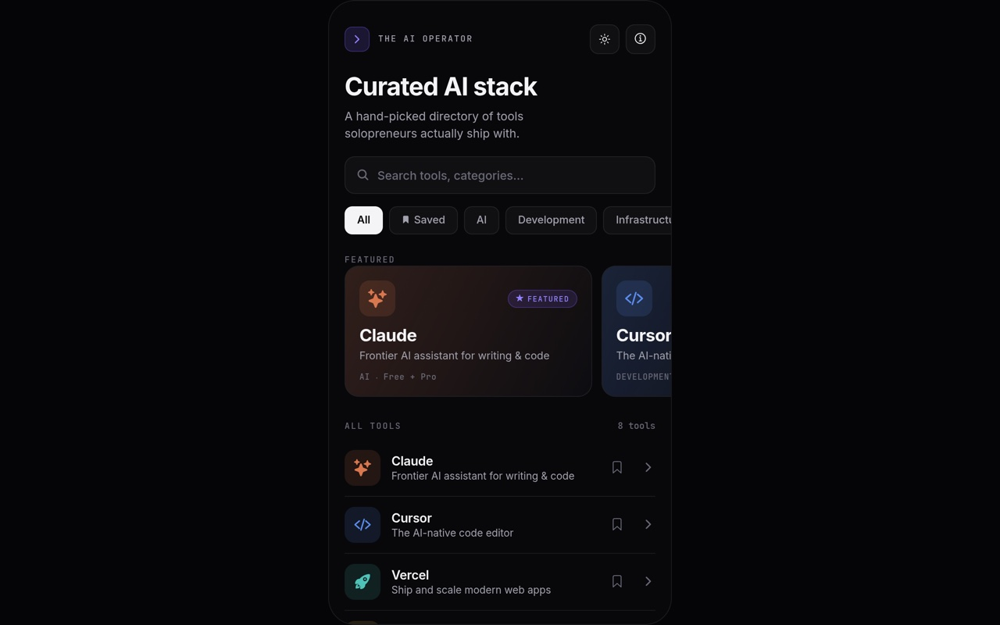

# AI Operator

A curated mobile directory of AI tools for solopreneurs.

**Live:** https://ai-operator-web.vercel.app



## What this is

A React Native app that curates AI tools worth using, with search, category filters, saved favourites, a featured carousel, light and dark themes and haptic feedback. The curation is the product: every tool in it was picked and written up by hand. Ships as a native app via Expo, with a web build deployed for anyone who wants to try it in a browser.

Built for solopreneurs who want a filtered list instead of another 500-tool spreadsheet.

This is a self-initiated concept project. It is not client work — I built it to learn
and to demonstrate what I can ship end to end.

## What I did

- Planned the project: page structure, section order, content and design direction
- Directed Claude Code to build it
- Reviewed the output and iterated on the design over many rounds
- Deployed it to Vercel

**How the code was written:** the code in this repository was AI-generated under my
direction, using Claude Code. I planned what it should do, reviewed what came back,
sent it round again until it was right, and tested it before deploying. My own
hands-on coding is HTML5 and CSS; I am currently learning JavaScript and full-stack
fundamentals so I can write the rest myself. I would rather state that plainly than
imply otherwise.

## Tech used

- React Native
- Expo
- TypeScript
- Deployed on Vercel

## Run it locally

```bash
git clone https://github.com/artem-shap/ai-operator.git
cd ai-operator
npm install
npx expo start
```

Then open Expo Go on your phone, or press w for web.

## Contact

Artem Shapovalov — [portfolio](https://artem-portfolio-ebon.vercel.app) — Wertyjon2@gmail.com
